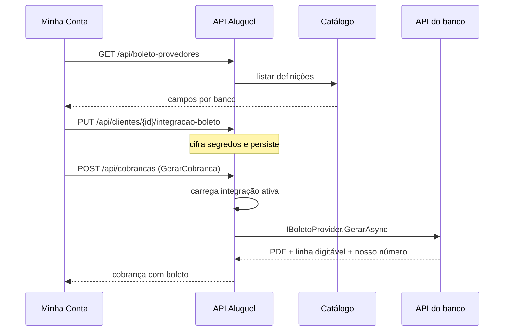

# 13 — Integração boleto bancário (catálogo expansível)

Geração de boletos de cobrança de aluguel via **API do banco/fintech** cadastrado no cliente. O módulo só aparece quando o plano permite Cobrança (`Plano.PermiteNfse` / `PermiteModuloCobranca`).

## Provedores iniciais

| Código | Nome | FEBRABAN |
|--------|------|----------|
| `itau` | Itaú | 341 |
| `bradesco` | Bradesco | 237 |
| `banco_do_brasil` | Banco do Brasil | 001 |
| `santander` | Santander | 033 |
| `caixa` | Caixa Econômica Federal | 104 |
| `sicredi` | Sicredi | 748 |
| `mercado_pago` | Mercado Pago | — |
| `inter` | Banco Inter | 077 |
| `c6` | C6 Bank | 336 |
| `nubank` | Nubank | 260 |

Campos por provedor vivem em `ProvedorBoletoCatalogo` (Application). Segredos (`client_secret`, `access_token`, …) são cifrados com `ISecretProtector` e **nunca** retornam em claro na API.

## Extensão (novo banco)

1. Adicionar entrada em `ProvedorBoletoCatalogo` com os campos da API.
2. Criar adapter `IBoletoProvider` em `Infrastructure/Integrations/BoletoBancario/` (herdar `BoletoProviderBase`).
3. Registrar o adapter em `DependencyInjection.AddInfrastructure`.
4. (Opcional) URL em `Boleto:BaseUrls:{codigo}` no `appsettings`.

Não é necessário migration de schema: a entidade `integracao_boleto_cliente` guarda `provedor_codigo` + JSON de campos.

## Fluxo

## Ambiente

- `Boleto:Ambiente=Mock` (padrão em Development): adapters geram PDF/linha localmente com o código FEBRABAN do banco — adequado a demos sem credenciais reais.
- `Homologacao` / `Producao`: cada adapter chama a HTTP API do provedor (`Boleto:BaseUrls` ou URL padrão do adapter).

## Persistência

Tabela `app.integracao_boleto_cliente`:

- `provedor_codigo`, `configuracao_publica_json` (jsonb), `segredos_cifrados` (bytea)
- índice único parcial: um registro ativo por `cliente_id`

Em `app.boleto`: colunas `provedor_codigo` e `id_externo` para rastreio da emissão.
