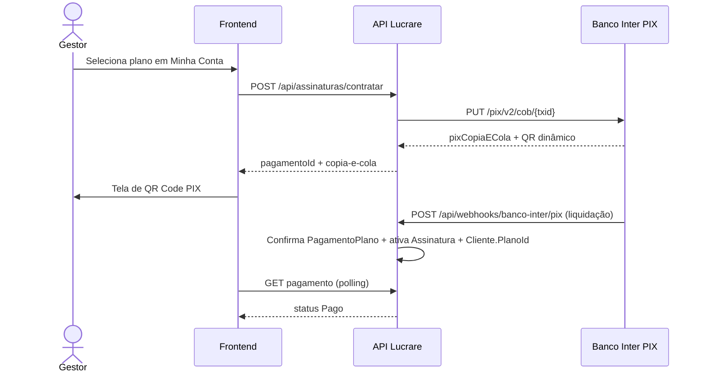

# 15 — Integração PIX de assinatura (Banco Inter)

Rastreabilidade: especificação §3 (contratação / renovação / reativação).

## Objetivo

Receber o pagamento do **plano SaaS** via **PIX** na conta corrente da
**TTHIMOTEO Consultoria e Serviços de Eng. Ltda** (CNPJ `15.809.930/0001-68`),
Banco Inter CC `44588184-4`, sem Mercado Pago neste momento.

> Distinto da integração de **boleto por cliente** (`13-Integracao-Boleto-Bancario.md`),
> cujas credenciais são do emitente do aluguel. Aqui as credenciais são da **plataforma**.

## Fluxo

1. Usuário (Gestor) contrata plano.
2. Sistema cria cobrança PIX imediata (`txid` 26–35) via API Inter.
3. Banco Inter devolve QR Code dinâmico (`pixCopiaECola`).
4. Banco Inter notifica liquidação no webhook.
5. Sistema marca pagamento como `Pago`, assinatura `Ativa` e aplica o plano ao cliente.

## Configuração (`InterPix`)

| Chave | Descrição |
|---|---|
| `Ambiente` | `Mock` (dev) · `Homologacao` · `Producao` |
| `ClientId` / `ClientSecret` | OAuth client_credentials Inter |
| `ChavePix` | Chave PIX da conta TTHIMOTEO |
| `ContaCorrente` | `44588184-4` |
| `CertificadoPath` / `CertificadoSenha` | mTLS (PKCS#12) exigido pela API Inter |
| `Beneficiario*` | Dados exibidos na UI de pagamento |

Em `Ambiente=Mock` o provider gera payload EMV-like local e o endpoint
`POST /api/assinaturas/pagamentos/{id}/simular-pagamento` (Development) emula o webhook.

## Endpoints

| Método | Rota | Auth | Função |
|---|---|---|---|
| `POST` | `/api/assinaturas/contratar` | Gestor | Cria cobrança PIX |
| `GET` | `/api/assinaturas/pagamentos/{id}` | Autenticado (escopo cliente) | Status / QR |
| `POST` | `/api/webhooks/banco-inter/pix` | Anônimo | Liquidação Inter |
| `POST` | `/api/assinaturas/pagamentos/{id}/simular-pagamento` | Gestor/Admin · Dev | Mock |

## Entidades

- `Assinatura` — `SolicitarContratacao` → `PendentePagamento`; `AtivarAposPagamento` → `Ativa`.
- `PagamentoPlano` — campos PIX: `PixTxId`, `PixCopiaCola`, `PixQrCodeBase64`, `PixEndToEndId`, `PlanoDestinoId`.
- `AuditoriaAssinatura` — eventos `Contratacao` / `Upgrade` / `Downgrade` / `Pagamento`.

## Ciclo de vida (recorrência mensal)

| Operação | Quando | Efeito |
|---|---|---|
| **Upgrade** | Imediato | PIX do novo valor; após liquidação reinicia `ProximaCobranca`/`FimCicloPago` |
| **Downgrade** | Próxima renovação | Valida limites; agenda `PlanoAgendadoId`; sem estorno/crédito |
| **Cancelamento** | Fim do ciclo pago | Acesso até `FimCicloPago`; depois `Cancelada` + cliente `Bloqueado` (login negado) |
| **Renovação** | `ProximaCobranca` | Job horário aplica downgrade agendado (se houver) e gera PIX |

Endpoints adicionais: `GET /atual`, `POST /cancelar`, `POST /revogar-cancelamento`, `POST /processar-ciclo` (Admin).

## Limitações atuais

- Somente **PIX** (cartão/Mercado Pago fora de escopo).
- Plano **Pro** (valor nulo) permanece sob consulta — sem self-service.
